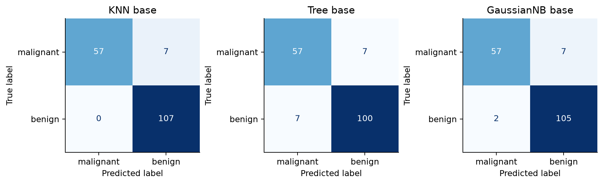
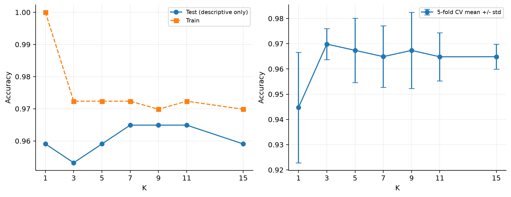
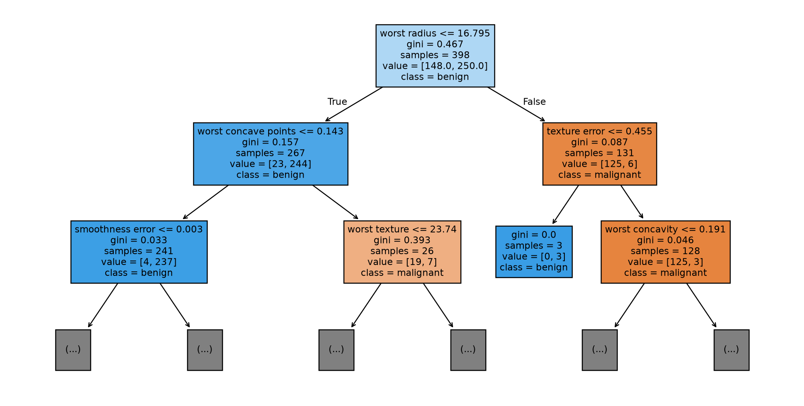
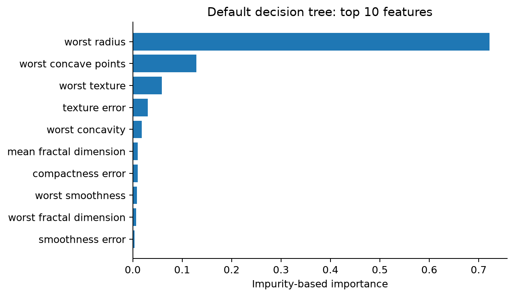
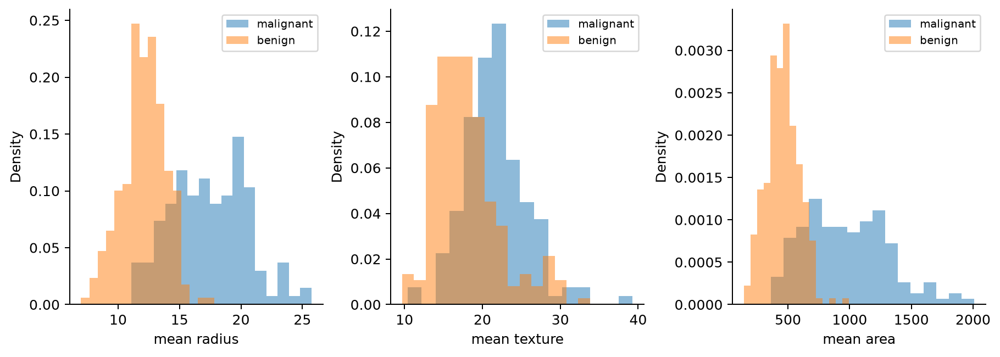
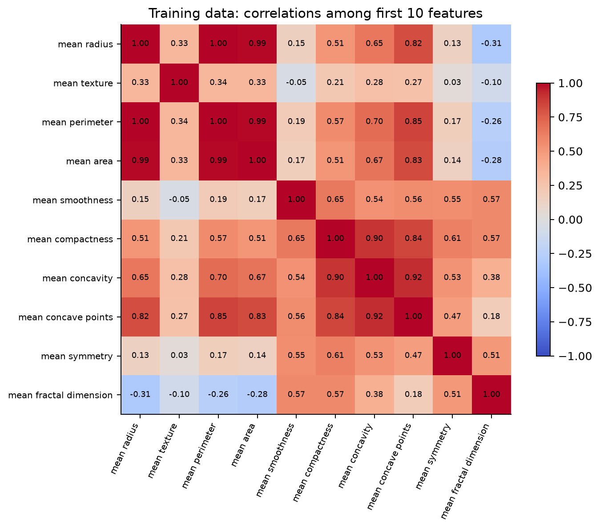
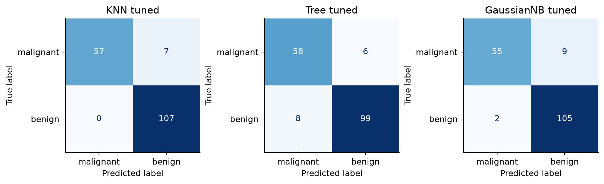
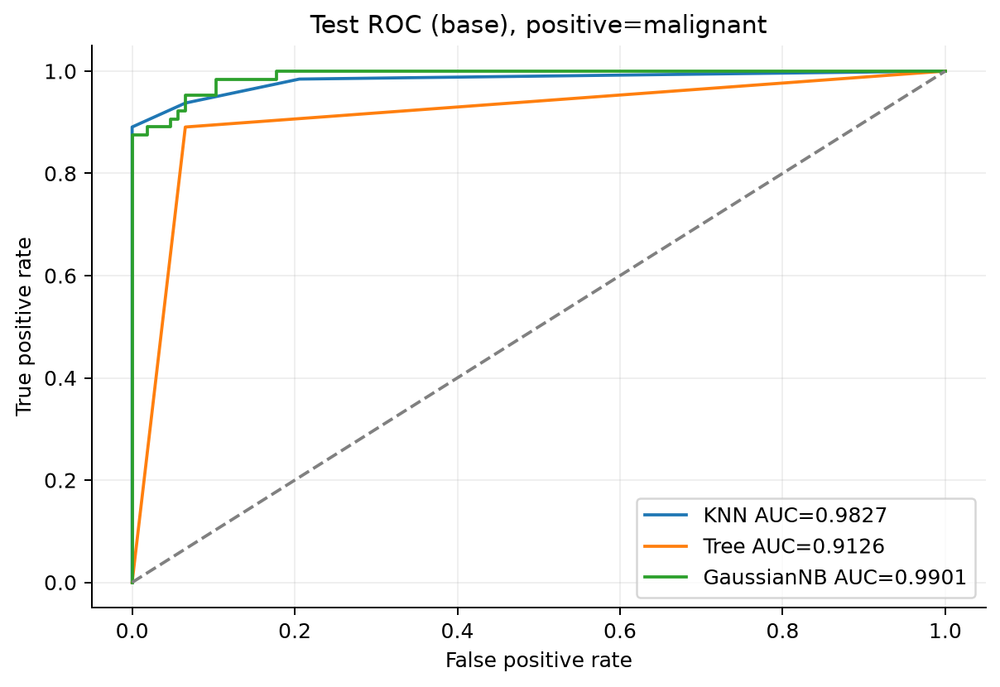
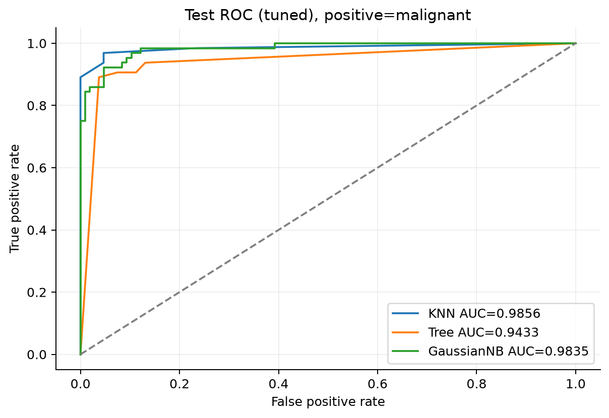

# 实验二 分类算法

何霖洁 · 2410311413 · 24计科4班 · 2026.10.27

# 实验二 分类算法

本实验使用乳腺癌数据，按指导书的六个步骤完成分类、评估和调参。在本次固定拆分中，KNN 的测试准确率为 0.9591，高于决策树和高斯朴素贝叶斯基线；但调参并没有让三种模型的测试结果都变好，后面结合混淆矩阵和交叉验证结果具体分析。

## 实验目的

1. 理解分类任务与有监督学习的基本流程。

2. 掌握 KNN、决策树和朴素贝叶斯的原理与实现。

3. 理解准确率、精确率、召回率、F1、混淆矩阵和 ROC/AUC 的含义。

4. 使用五折交叉验证和网格搜索调参，并比较调优前后的实际变化。

5. 结合特征尺度、分布和相关性，分析不同算法的适用性与局限。

## 实验原理

### K 近邻

KNN 保存训练样本，预测时计算距离，找到最近的 K 个邻居并投票。K 较小时，个别噪声样本可能改变结果；K 较大时，局部边界可能被平滑掉。本次默认 K=5、均匀投票，使用 Z-score 标准化，使面积等大数值尺度的特征不至于直接主导距离。

### 决策树

CART 分类树选择特征和阈值，使分裂后的基尼不纯度下降。基尼不纯度可写为 1−Σp²，其中 p 为节点内各类别的比例。决策树沿一系列条件形成分类规则。树过深时可能记住少数训练样本，本次同时比较限制深度和节点样本数的预剪枝，以及 ccp_alpha 控制的代价复杂度后剪枝。

### 朴素贝叶斯

朴素贝叶斯利用 P(y|x)∝P(y)∏P(xj|y) 计算类别分数，简化条件是给定类别后各特征独立。GaussianNB 用高斯分布描述类内连续特征，MultinomialNB 更适合非负计数或频率，BernoulliNB 适合二值特征。能接受某种数值输入，并不表示这个分布假设就符合数据。

### 评估与交叉验证

本报告将恶性作为正类，保留数据原标签 0=恶性、1=良性。TP 为检出的恶性，FN 为漏检，FP 为把良性误判为恶性。准确率=(TP+TN)/N，精确率=TP/(TP+FP)，召回率=TP/(TP+FN)，F1 为精确率和召回率的调和平均。分类报告另外保留良性这一类的指标。

ROC 使用恶性预测概率，横轴是假正率，纵轴是真正率。AUC 衡量概率排序的区分能力，与默认投票或默认概率决策下的准确率不是同一个量。五折交叉验证只在训练集内进行，以验证准确率均值选择参数；标准化放进 Pipeline，每折都只拟合该折的训练部分。

## 实验环境

表 1  实验环境

|项目|记录|
|---|---|
|运行方式|VS Code / PowerShell；独立 Python 脚本|
|Python|3.11.17；conda 环境 dm-labs|
|依赖|NumPy 2.4.6；Pandas 3.0.6；Scikit-learn 1.9.1；Matplotlib 3.11.2|
|系统|Windows x64；platform 输出 build 26200|
|CPU|AMD Ryzen 7 8845H w/ Radeon 780M Graphics|
|内存|系统报告物理内存 16,421,982,208 字节，约 15.29 GiB|
|运行日期|2026.10.27；先前数据检查与 KNN 基线保留原记录|

完整依赖快照保存在 requirements.txt。前期数据检查和 KNN 基线由我运行；本次因时间安排，后续完整运行、复跑核验和材料整理使用了 AI 辅助。日志区分了执行来源，没有把自动运行写成我已独立完成的课堂操作。

## 实验数据

使用 sklearn.datasets.load_breast_cancer 加载 569 个样本、30 个连续数值特征，目标为恶性和良性。全部特征均为有限数值，没有缺失；本次未人为添加缺失或删除异常样本。类别数量为恶性 212、良性 357，良性约占 62.74%，存在一定比例差异，但并不是思考题假设的恶性仅占 5%。

表 2  分层拆分后的类别分布

|数据|总数|恶性 0|良性 1|
|---|---|---|---|
|全部|569|212|357|
|训练集|398|148|250|
|测试集|171|64|107|

按 70%/30% 拆分，设置 random_state=42、stratify=y。这里保留原标签后再拆分，与前面亲自运行的数据检查保持一致。只写随机种子还不够，如果先交换标签编号再分层拆分，得到的具体样本索引可能不同，因此本次同时导出 split_indices.csv。

## 实验内容与步骤

下面按指导书的 Step 1–6 说明过程。片段省略重复导入和保存设置，完整实现见 run_all.py；最终图表与数据统一取自 final_results，不混用其他教学示例目录中的结果。

### Step 1 数据加载与预处理

检查维度和类别，保存训练/测试索引。KNN 使用 StandardScaler；决策树和默认 GaussianNB 使用原始连续特征，便于直接解释树阈值并保留默认高斯模型的平滑口径。另做标准化对照，验证尺度对 KNN 和树的影响。

```python
data = load_breast_cancer()
X, y = data.data, data.target
train_idx, test_idx = train_test_split(
    np.arange(len(y)), test_size=0.3,
    random_state=42, stratify=y)
Xt, Xv = X[train_idx], X[test_idx]
yt, yv = y[train_idx], y[test_idx]
```

### Step 2 KNN 分类与 K 值比较

先训练 K=5，保存两类分类报告、混淆矩阵及恶性概率。再尝试 K=1、3、5、7、9、11、15，绘制测试准确率曲线和训练集内的交叉验证曲线。测试曲线按老师要求作描述，选参仍以训练集 CV 为依据。

```python
knn = Pipeline([("scale", StandardScaler()),
    ("model", KNeighborsClassifier(n_neighbors=5))])
knn.fit(Xt, yt)
pred = knn.predict(Xv)
p0 = knn.predict_proba(Xv)[:, list(knn.classes_).index(0)]
auc = roc_auc_score(yv == 0, p0)
```

### Step 3 决策树分类与结构解释

用 DecisionTreeClassifier(random_state=42) 训练默认 CART。输出评估、完整树图、前三层树图和特征重要性，再用第一个测试样本逐节点核对决策路径。只固定随机种子，未给基线加入深度限制。

```python
tree = DecisionTreeClassifier(random_state=42)
tree.fit(Xt, yt)
plot_tree(tree, feature_names=data.feature_names,
    class_names=["malignant", "benign"], filled=True)
importance = tree.feature_importances_
```

### Step 4 朴素贝叶斯及变体

GaussianNB 直接拟合原始连续值。MultinomialNB 使用原始非负值，作为分布假设不完全合适时的对照，不把它描述成真实计数数据。BernoulliNB 先按训练均值标准化，再以 0 为阈值二值化，等价于判断是否超过训练均值；每折验证时在 Pipeline 内重新拟合。

```python
gaussian = GaussianNB()
multinomial = MultinomialNB()
bernoulli = Pipeline([("scale", StandardScaler()),
    ("binary", Binarizer(threshold=0)),
    ("model", BernoulliNB(binarize=None))])
```

### Step 5 五折交叉验证与网格搜索

统一使用 StratifiedKFold(n_splits=5, shuffle=True, random_state=42)，以 accuracy 为评分。网格在本次运行前固定。KNN 搜索 14 组、决策树 36 组、高斯贝叶斯 7 组，每组做五折验证，选出最高均值后在全部训练集重拟合。

表 3  参数搜索范围

|模型|搜索参数|
|---|---|
|KNN|K∈{1,3,5,7,9,11,15}；距离为 euclidean、manhattan|
|决策树|max_depth∈{None,3,5,7}；min_samples_split∈{2,5,10}；min_samples_leaf∈{1,2,5}|
|GaussianNB|var_smoothing∈{10⁻¹²,10⁻¹¹,10⁻¹⁰,10⁻⁹,10⁻⁸,10⁻⁷,10⁻⁶}|
|后剪枝附加实验|ccp_alpha∈{0,0.001,0.005,0.01,0.02}|

```python
search = GridSearchCV(estimator, param_grid,
    cv=cv, scoring="accuracy", n_jobs=1,
    return_train_score=True, error_score="raise")
search.fit(Xt, yt)
best = search.best_estimator_
```

### Step 6 算法对比与复现检查

统一比较准确率、恶性精确率、召回率、F1、AUC 和拟合时间，分别绘制基线与调优后的同图 ROC。拟合时间使用 perf_counter，KNN 包含 Pipeline 中的标准化，不含预测和搜索总时间；因此只能作为本次小数据实验的记录，不能代替严格的速度基准。最后在新进程从头复跑，并从保存的逐样本预测独立重算指标。

## 实验结果与分析

### 1 数据检查与尺度对照

实际得到训练集 398 条、测试集 171 条，与我事前计算一致。训练集标准化后的均值约为 0、总体标准差为 1，测试集前三特征均值分别为 0.031932、−0.038410、0.037394。这与我之前的解释相符：测试集不是同一批数据，使用训练集统计量变换后，自身均值不必也为 0。

表 4  标准化影响对照

|模型与输入|准确率|恶性 F1|AUC|
|---|---|---|---|
|KNN 原始尺度|0.9240|0.8976|0.9489|
|KNN 标准化|0.9591|0.9421|0.9827|
|决策树 原始尺度|0.9181|0.8906|0.9126|
|决策树 标准化|0.9181|0.8906|0.9126|

KNN 标准化后准确率由 0.9240 提高到 0.9591，主要变化是良性误报由 6 个减少到 0 个，恶性漏检仍为 7 个。不能把准确率提高直接解释为所有类别都改善。决策树在两种尺度下的测试预测完全相同，符合它依据单特征阈值而不是距离分裂的特点。

### 2 KNN 基线与 K 值曲线

K=5 的混淆矩阵为 [[57,7],[0,107]]，行是真实类别，列是预测类别，顺序均为恶性、良性。64 个恶性样本检出 57 个，漏检 7 个；107 个良性样本均正确判断。恶性召回率为 57/(57+7)=0.890625，精确率为 57/(57+0)=1。精确率等于 1，并不表示没有漏检。



表 5  K 值与准确率 欧氏距离

|K|训练准确率|测试准确率|CV均值|CV标准差|
|---|---|---|---|---|
|1|1.0000|0.9591|0.9447|0.0219|
|3|0.9724|0.9532|0.9698|0.0062|
|5|0.9724|0.9591|0.9674|0.0127|
|7|0.9724|0.9649|0.9649|0.0122|
|9|0.9698|0.9649|0.9673|0.0151|
|11|0.9724|0.9649|0.9648|0.0095|
|15|0.9698|0.9591|0.9648|0.0049|



我之前判断 K=1 更容易受个别噪声影响，因为它只参考一个邻居。实际 K=1 的训练准确率为 1，但 CV 均值为 0.9447，低于 K=3 的 0.9698。这与小 K 容易记住局部样本的解释相符，不过单次实验不能证明每个错误都来自噪声。

K 增大后测试准确率并不单调变化，K=7、9、11 在欧氏距离下都得到 0.9649。综合两种距离的 CV，最终选择的是 K=7、曼哈顿距离。它的测试准确率仍为 0.9591，说明 CV 选出的参数没有义务恰好在这 171 条测试样本上最好。

### 3 决策树结构与特征重要性

默认树深度为 6、叶节点 16 个，训练准确率为 1，测试准确率为 0.9181。它在测试集漏检 7 个恶性，也误报 7 个良性。训练结果很好而测试结果下降，提示树对训练细节拟合得较充分，仍需结合 CV 和剪枝对照判断。



根节点比较 worst radius 与约 16.795 的阈值。第一个测试样本对应原始行号 14：worst radius=15.03，走左支；worst concave points=0.2208>0.14315，走右支；worst texture=32.01>23.74，继续右支；mean fractal dimension=0.07682>0.06088，最终预测为恶性，与标签一致。前三层图只用于阅读，完整树和文字规则另存，不能把截断图当成完整模型。

表 6  默认树前五个特征重要性

|特征|重要性|
|---|---|
|worst radius|0.7215|
|worst concave points|0.1288|
|worst texture|0.0592|
|texture error|0.0301|
|worst concavity|0.0186|



worst radius 的重要性约为 0.7215，worst concave points 约为 0.1288。这里的重要性来自本棵树中不纯度的下降，不是因果贡献，也不表示其他特征没有信息。半径、周长、面积高度相关，树可能优先选其中一个，其他相关列的重要性就会被压低。

### 4 朴素贝叶斯与特征假设



数据是连续测量值，所以 GaussianNB 比计数型假设更容易解释。图中两个类别在半径、面积等特征上的分布有所区别，但直方图不能证明每一列都服从正态分布。默认 GaussianNB 的测试准确率为 0.9474，漏检 7 个、误报 2 个，AUC 为 0.9901。

表 7  三种贝叶斯变体对比

|变体|CV均值|准确率|恶性召回|恶性F1|AUC|
|---|---|---|---|---|---|
|高斯 默认|0.9271|0.9474|0.8906|0.9268|0.9901|
|Multinomial|0.8919|0.9006|0.7812|0.8547|0.9352|
|Bernoulli|0.9271|0.9415|0.9375|0.9231|0.9883|

MultinomialNB 的准确率为 0.9006，恶性召回率为 0.7813。原始数据虽然非负，仍不是各类事件的计数，特征之间的量纲差异也很大，直接套用多项式模型的解释较弱。BernoulliNB 二值化后准确率为 0.9415，恶性召回率达到 0.9375，但误报也增加到 6 个。二值化丢失了超过阈值多少的信息，因此不能只看某一个指标就认定这种表示更好。



训练集中 mean radius 与 mean perimeter 的相关系数为 0.9978，mean radius 与 mean area 为 0.9906。它们描述相近的形态信息，不能当作完全独立的证据反复累乘。相关性说明朴素假设并不严格成立，但不直接决定分类必然失败；GaussianNB 在本次测试中仍有较好的概率排序。

### 5 调优前后与交叉验证结果

表 8  最优参数与五折验证

|模型|最优参数|CV均值±标准差|
|---|---|---|
|KNN|K=7，manhattan|0.9724 ± 0.0094|
|决策树|depth=5；split=5；leaf=2|0.9347 ± 0.0202|
|GaussianNB|var_smoothing=10⁻⁷|0.9322 ± 0.0101|

表 9  调优前后测试性能 正类均为恶性

|模型|准确率|精确率|召回率|F1|AUC|
|---|---|---|---|---|---|
|KNN 基线|0.9591|1.0000|0.8906|0.9421|0.9827|
|KNN 调优|0.9591|1.0000|0.8906|0.9421|0.9856|
|Tree 基线|0.9181|0.8906|0.8906|0.8906|0.9126|
|Tree 调优|0.9181|0.8788|0.9062|0.8923|0.9433|
|GaussianNB 基线|0.9474|0.9661|0.8906|0.9268|0.9901|
|GaussianNB 调优|0.9357|0.9649|0.8594|0.9091|0.9835|

KNN 调参前后的分类标签相同，但 AUC 从 0.9827 变为 0.9856。分类报告只看最后的标签，ROC 还会使用不同阈值下的概率排序，所以两者不一定一起变化。

预剪枝后的树深度由 6 变为 5、叶节点由 16 变为 13。测试准确率仍为 0.9181，但恶性漏检由 7 个减为 6 个，良性误报由 7 个增为 8 个。总错误数相同，错误的类别发生了变化。附加后剪枝实验在训练 CV 中选择 ccp_alpha=0.005，树深为 4，测试准确率为 0.9298；它作为额外对照，不替换预剪枝的调优结果。

GaussianNB 的 CV 选择 var_smoothing=10⁻⁷，测试准确率反而从 0.9474 下降到 0.9357，恶性漏检从 7 个增加到 9 个。平滑强度改变了方差估计，而训练验证与测试只包含有限样本，表现不一定同步。我不会为了让表格看起来更好而继续根据测试集改搜索范围。



### 6 ROC 综合对比与训练时间





基线 KNN 的准确率和恶性 F1 较高，而 GaussianNB 的 AUC 最高，为 0.9901。这不矛盾：前者描述当前决策下的错误，后者描述概率排序。不能把 AUC=0.9901 写成准确率 99.01%，也不能因此认为已经满足实际诊断要求。

表 10  单次拟合耗时与网格搜索总耗时

|模型|基线拟合 ms|调优重拟合 ms|搜索总秒|
|---|---|---|---|
|KNN|1.3992|0.9663|0.6187|
|Tree|4.2449|3.5217|0.7147|
|GaussianNB|0.8883|0.6804|0.0735|

数据量只有 398 条训练样本，单次拟合都在毫秒量级，系统负载与计时精度会明显影响数字。KNN 拟合很快，不代表预测也最省时，因为预测还要查找邻居。这里没有做重复计时或大数据压力测试，所以时间表只记录本次运行，不能直接推广为算法速度排名。

## 思考题作答

### 1 KNN 中 K 值过小或过大分别会怎样 除网格搜索外怎样选择

K 太小时，决策会更依赖个别样本，方差可能较大；K 太大时，较远邻居也参与投票，局部边界容易被抹平，可能欠拟合。我的事前预测是 K=1 更容易受噪声影响，实际它的训练准确率为 1，而五折均值只有 0.9447。除网格搜索外，可以先依据经验如 √n 给出候选范围，再用独立验证集、留一验证或随机搜索比较，也可以尝试距离加权。经验公式只能给起点，最后仍要用验证结果判断。本次没有另外运行留一法或距离加权。

### 2 决策树怎样防止过拟合 预剪枝与后剪枝有什么区别

本次预剪枝搜索了最大深度、最小分裂样本数和最小叶节点样本数，让树在继续细分之前受到限制。默认树训练准确率为 1，调优后为 0.9849，深度和叶节点也减少，但测试准确率没有提升。因此，结构变简单不等于本次测试必然更好。后剪枝则从较完整的树出发，用复杂度惩罚衡量保留哪些子树。本次另外实际验证了 ccp_alpha，五折选择 0.005，得到深度 4、测试准确率 0.9298。两种剪枝都应在训练验证范围内选择，不能用测试结果反复决定保留哪棵树。

### 3 标准化对 KNN 和决策树的影响是否相同

不相同。KNN 的欧氏距离和曼哈顿距离都受特征尺度影响，不同量纲直接相加可能使大尺度特征占主导。标准化后本次 KNN 的准确率由 0.9240 提高到 0.9591。树只比较某一特征与阈值，正比例缩放和平移通常保持样本顺序，相应阈值变换后分组也保持。本次树的测试预测完全一致。不过，浮点精度、并列分裂和实现细节仍可能导致差异，不能把一次一致推广成所有计算都逐位相同。

### 4 相关特征怎样影响朴素贝叶斯 为什么假设不完全成立仍可能有效

半径、周长和面积的训练集相关性很强，例如 mean radius 与 mean perimeter 的 Pearson r 为 0.9978。条件独立假设下，模型可能把重复信息当成多份证据，影响后验概率的可靠程度。不过，边缘相关也不等于已严格检验了各类内部的条件独立性；这里能说明假设值得怀疑，不能把相关系数当成完整的独立性检验。即使概率估计有偏，只要类别分数的相对顺序仍有效，模型仍可能分对很多样本。本次默认 GaussianNB 的准确率为 0.9474、AUC 为 0.9901，但这不能证明概率已校准，也不能证明相关性没有影响。

### 5 三种算法的建模思想有什么区别 强相关或高维时怎样选择

朴素贝叶斯通过概率分布与先验计算类别分数，决策树学习一组逐层划分的规则，KNN 则保留实例，在预测时比较相似程度。强相关时，贝叶斯可能重复计算证据，树的重要性可能集中在相关列中的某一列，KNN 的距离也可能重复强调同类信息。维度很高时，KNN 容易受到无关特征和距离集中现象影响，存储与预测代价也会上升。高维稀疏计数可以先考虑多项式贝叶斯，连续低维任务可以比较标准化 KNN 与高斯贝叶斯，需要清楚规则时再关注树。特征选择或 PCA 应放在训练验证流程内；本次没有实际执行降维，不能宣称它一定改善结果。

### 6 诊断场景优先优化什么 恶性仅占百分之五时怎样处理

在辅助发现恶性的假设场景中，我会优先关注恶性召回率，因为漏检可能延误进一步检查；同时仍需限制误报，避免把大量良性样本送去不必要的检查。不能只把召回率拉到 1 就认为完成任务，还要结合精确率、F1、检查成本和临床流程决定阈值。如果恶性仅占 5%，全部预测良性也有 95% 准确率，但恶性召回率为 0，所以应同时看分类别指标、混淆矩阵和 PR 曲线。可以在训练折内重采样、对支持的模型使用类别权重，或在验证集上调整概率阈值；阈值和采样参数也不能在测试集选择。实际使用前还需要外部人群验证、概率校准、隐私保护和人工复核。本实验未模拟 5% 分布，未部署诊断系统，这部分是方法讨论。

## 实验总结

这次结果最值得保留的地方，是调参后的表现没有统一提升。KNN 分类结果不变，树的漏检和误报发生了交换，高斯贝叶斯的测试准确率下降。只写一个“最好准确率”会丢掉这些差别，因此我更关注它到底把哪一类分错，以及选择参数的依据来自哪里。

前期亲自操作时遇到过路径错误：终端已经在 lab2，命令又添加了一层 lab2，导致日志目录不存在。改用当前目录下的脚本路径后运行成功。完整运行时又出现 NumPy 整数不能直接写入 JSON 的问题，已将其转换为 Python 标量后重新运行；拟合耗时也改为统一的高精度计时。失败日志保留，没有从失败运行中拼接最终结论。

最终核验从保存的逐样本预测重算指标，并在新进程重新运行全部配置，除耗时外结果一致。前面的数据检查和 KNN 基线也与本次结果相符。实验仍只使用一个公开数据集和一次固定外部分割，五折标准差也不是置信区间；因此可以比较这些方法在当前设置下的表现，不能据此证明某种模型适合直接用于真实诊断。

### 附录 实验仓库与复现材料

GitHub 课程仓库：https://github.com/lhe-xi/data-mining-lab1 。本次实验材料位于 lab2/，包括完整脚本、依赖、逐样本预测、CV 明细、图表、运行日志和本报告。

```python
cd lab2
python -m pip install -r requirements.txt
python run_all.py
python validate_results.py --rerun
```

final_results/ 是最终报告的数据来源；results/ 是前期教学示例，采用了不同的标签处理和拆分，不用于本报告。完整树图 tree_full.png、文字规则 tree_rules.txt 和全部分类报告另外保存，便于放大阅读与复核。
